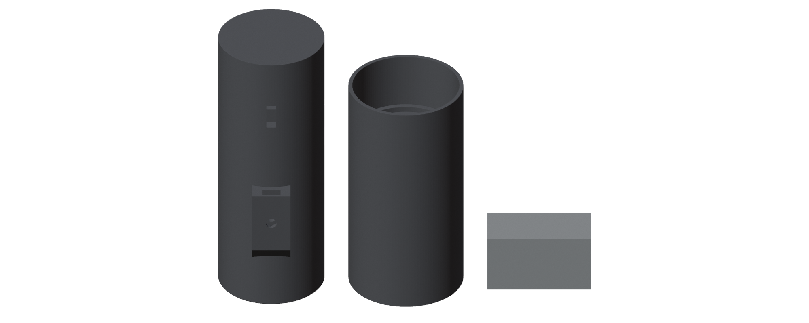
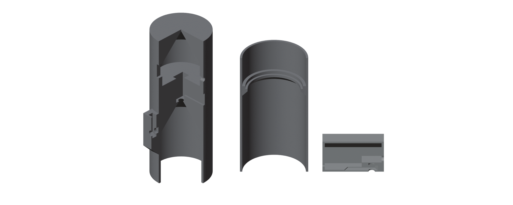

# The beam's enclosures, the electronics printed in

Made in Blender 5.3 by `embedded_enclosures.py`. `stl/` has one print file per part, already
in its print orientation, in millimetres. `embedded_enclosures.blend` keeps the same parts for
editing. The printer pauses, the electronics are laid in, and the print closes over them:
three parts, all PETG, no screws, the cables and the hood sealed with neutral-cure silicone
(spec 002, FR-013, FR-016). It has not been printed yet.

This is one of two versions, kept side by side until printed ones choose between them. The
other, [`../enclosures/`](../enclosures/README.md), is assembled from six parts and can be
opened again.

| | Assembled (`../enclosures/`) | Printed in (here) |
| --- | --- | --- |
| Printed parts | 6 | 3 |
| Screws | 2 | none |
| The print | no pause | a pause in two of the parts, the electronics laid in by hand |
| Opened again | cut the silicone, take out the back cap's screws | no: what is inside stays inside |
| Focus | the sensor's carriage, slid in the tube | the hood with the lens, slid on the body |
| The trimmer | set before the back cap goes on | set through a hole, then the hole sealed |
| The USB cable | through the back cap's slot | a short extension, laid in at the pause |

## The parts

| File | Count | What it is |
| --- | --- | --- |
| `receiver_body.stl` | 1 | The receiver's body: a bore for the light, narrowing to the photoresistor's window; the light sensor module's slot behind it; a bay for the board (and the BT05) that its roof closes after the pause; a boss underneath for a camera tripod. |
| `receiver_hood.stl` | 1 | Holds the lens on a shoulder and slides over the body's front: how far focuses the lens. It reaches 100 mm ahead of the lens: keeps the sun from the side, rain and dew off it. |
| `emitter.stl` | 1 | The laser's box: the laser on a ledge, shining through a hole in the front, its power module behind it; its roof closes over them after the pause. |

## Printing

- **PETG.** 0.2 mm layers, the first one too: each pause falls between two of them. 4 walls,
  5 top and bottom layers, 25 to 40% infill, no supports. Every part lies on the print bed as
  exported.
- **The receiver's two parts in black**, so that no daylight comes through their walls and
  none is reflected inside onto the sensor. **The emitter in a light colour**, white or light
  grey: in the sun it stays cooler than a dark box, and a laser diode dims and wears out when
  it is hot.
- The body is 177 mm tall, standing on its front; the hood 142 mm, on its front; the emitter
  37 mm, on its floor. Every roof and slope inside is at 45 degrees, so none needs support.
- **A 5 mm brim for the body and the hood.** Each stands on a ring a few millimetres wide,
  and a tall part on so little can come off the bed late in its print.
- **The pauses.** In the slicer, pause the body's print before its first layer above
  147.0 mm, and the emitter's above 22.4 mm; the hood has none. PrusaSlicer, Bambu Studio
  and OrcaSlicer add a pause on the layer slider; Cura through Extensions, Post Processing,
  Pause at height. In the slicer's preview, the last layer before the pause still has the
  bay open. These heights are for the numbers in the script, which says them when it runs.
- **What is laid in stays below the pause's height:** the nozzle passes over it next.
  The cable then hangs out of the part to the end of the print: tape it to the bed beside
  the part, so that a moving bed or head cannot catch it.
- **Heat.** The body's bay is 12 cm above the bed, where the photoresistor (good to 70
  degrees) stays cool. The emitter's laser lies 1 cm above it while the roof prints: if the
  printer lets you, turn the bed down to 60 degrees at the pause; the part still holds.

## What else to buy

| Part | Count | Where it goes |
| --- | --- | --- |
| A 3x hand magnifier, 60 mm glass lens | 1 | Its lens, out of its frame, into the hood (see "The lens" below). |
| Red film: a lighting gel, or a red transparent folder | a 10 mm square | Over the photoresistor: it lets the red laser through and holds most of the daylight back (FR-012). |
| A USB-C extension cable, male to female, 30 to 50 cm | 2 | One in each part: its plug in the board or the power module, laid in at the pause; its socket outside, where the power bank or the computer plugs in. |
| Neutral-cure silicone sealant, black or grey | 1 tube | The lens in the hood, the hood on the body, the cable slots, the trimmer's hole. Not an acetic one, which smells of vinegar: its acid corrodes the boards. |
| Clear neutral-cure silicone, or clear epoxy | a drop | The board's LED window. |
| 1/4-20 hex nut (camera thread) | 2 | One slid into the body's boss after the print, one into the emitter's ledge at its pause. |
| Hot glue | | The emitter's nut, its laser's board and barrel; over the body's nut. |
| Foam tape, double-sided | a few cm | The board, the BT05 and the power module, fixed in place at the pause. |
| Black tape (electrical tape) | a few cm | Round the sensor module where it leaves its slot. |
| A small bag of silica gel (as comes in a shoe box) | 2 | One in each part, laid in at the pause: it keeps the lens from misting inside. |
| A camera tripod with a pan and tilt head | 2 | One for the receiver, one for the emitter: aiming them. |

## Before the print

Whatever is laid in is sealed in for good, and no wire can be pushed back on afterwards:

1. **Build it and try it first.** Wire the receiver's board to the sensor (and the BT05),
   flash it and check its clock (`beam/README.md`, steps 1 to 3). Wire the laser to its
   power module, VBUS to its `S` pin and GND to its `-` pin, with the 47 Ohm 1 W load across
   them if the power bank needs one (`beam/README.md`), and check that it shines.
2. **Fix every wire:** solder it, or put a dab of hot glue on each Dupont connector.
3. **The photoresistor.** Stick a square of red film over it, and bend its leads so that it
   faces forward, past the end of the module's board, at its middle.
4. **The cables.** Plug an extension cable into the board, the other into the power module.
5. **Measure.** The module's slot is 9.5 by 14.6 mm and 30 mm deep, its trimmer reached
   8 to 22 mm from the module's front end and up to 3 mm off its middle; the bay is 56 mm
   across and 28 deep; the emitter 60 by 26 by 20 mm inside. Parts that do not fit change the numbers at the top of
   `embedded_enclosures.py`, under "what is laid in at the pauses"; then build the parts
   again (below).

## The receiver

1. **Print the body,** pausing at 147.0 mm. At the pause, without pushing the part off its
   bed:
   - Push the sensor module into the slot in the bay's floor, photoresistor first, its
     parts (the trimmer) facing the side with the two holes, until its board stops. Wrap a
     turn of black tape round it where it leaves the slot, so that no light in the bay
     reaches the photoresistor round it.
   - Fix the board (and the BT05) in the bay with foam tape, the board's LED against the
     window in the bay's wall, on the same side as the trimmer's hole.
   - Lay the extension cable down into the slot in the bay's wall above the boss, its
     socket outside.
   - Put a bag of silica gel in the bay. Lay a ruler across the top: nothing may touch it.
     Then resume the print.
2. **The lens.** Push the lens into the hood from its back until it rests on the shoulder.
   Run a bead of silicone round its edge from the back, where it meets the bore. Leave the
   hood standing on its front for a day while the silicone cures.
3. **Focus.** Slide the hood over the body's front until a ruler from the hood's back edge
   to the body's back end reads the lens's focal length and 52 mm: 152 mm for a 100 mm
   lens. A few millimetres either way do not matter.
4. **The trimmer.** Power the receiver and aim the laser at its lens. Through the hole
   beside the module, turn the trimmer with a small screwdriver until the board's LED, in
   its window, is just lit, and goes out when the beam is blocked (`beam/README.md`,
   step 4). Then fill the hole with silicone.
5. **Seal it.** Run a bead of silicone round the hood's back edge, on the body. Fill the
   cable's slot round the cable with silicone, and the LED window with clear silicone or
   epoxy.
6. **Tripod.** Slide a 1/4-20 nut into the slot in the boss's top, from the body's back end
   side, until it drops to the bottom, and put a dab of hot glue over it: the slot opens
   along the body, and off its tripod the receiver would shake the nut out. The tripod's
   screw goes into the hole in the boss's face; the plastic between them takes the pull, so
   a tightened screw cannot pull the nut out. Tie the cable to a leg of the tripod, the
   emitter's as well: a foot caught in it then pulls the tripod, not the cable out of its
   silicone.

## The emitter

1. **Print it,** pausing at 22.4 mm. At the pause:
   - Slide a 1/4-20 nut into the slot at the back of the ledge until it is over the hole in
     the floor, and put a dab of hot glue over the slot's mouth.
   - Lay the KY-008 on the ledge against the front wall, its barrel at the hole, and fix its
     board with a dab of hot glue: once aimed, the laser must not move. Run a ring of hot
     glue round the barrel where it meets the front wall, inside, and keep it off the
     barrel's front: glue on the laser's glass would smear the spot at 10 m.
   - Fix the power module to the floor behind it with foam tape. The load, if there is
     one, turns half a watt into heat, its body near 100 degrees: stand it on its leads
     clear of the walls and the floor, where it cannot soften the PETG (about 80 degrees).
   - Lay the extension cable down into the slot in the back wall, its socket outside. Put
     a bag of silica gel in. Nothing may stand above the walls. Then resume the print.
2. **Seal it.** Fill the cable's slot round the cable with silicone.

## The lens

The receiver is made for a 60 mm lens that focuses about 100 mm behind itself. A 3x hand
magnifier's lens is about that. Over 10 m, a lens catches the laser's spot anywhere on its
face and focuses it onto the sensor, so the spot may wander up to 2.5 cm without the beam
being lost. A bare sensor loses it after 3 mm (spec 002, FR-009, FR-012).

To find a lens's focal length, focus the sun, or a lamp across the room, onto a sheet of
paper: the distance from the lens to the sharpest spot is its focal length. Pushed fully
onto the body, the hood suits a lens of 90 mm; pulled 20 mm further off, one of 110 mm. A
lens further off changes three numbers at the top of `embedded_enclosures.py`: `LENS_D`
(its diameter), `LENS_EDGE` (its thickness at the rim) and `FOCAL`. Then build the parts
again (below).

Along the body, 5 mm off the focus still puts the whole spot on the photoresistor. Across
it, a lens a little off centre puts the spot a millimetre aside, and turning the receiver
half a degree on its tripod brings it back, as aiming does anyway.

**A lens is a burning glass.** In the sun it focuses 2 to 3 W into a spot of about a
millimetre. With the sun within some 17 degrees of the body's axis, that spot falls inside
the body, on its cone or on the photoresistor: it can melt the one and burn the other. Set
the receiver up with its back to the sun, the laser on the sunny side, and never leave it
lying lens up in the sun. The hood keeps off the sun further aside.

## Sealing

Every opening the print leaves is sealed with neutral-cure silicone: the lens in the hood,
the hood on the body, the cable slots and the trimmer's hole; the LED window with a clear
one. Nothing is a gasket. The cables stay plugged in: the board is re-flashed and the power
bank changed through them, without opening anything (FR-013). Nothing can be opened either:
a board that fails is cut out, and its part printed again. Whether this keeps out rain, dust
and dew, as an IP65 class, is found once the first ones are printed and sprayed (spec 002,
T018).

## Building the parts again

The script makes every part, writes `stl/` (removing the files of parts it no longer makes),
`preview.png`, `section.png` and `embedded_enclosures.blend` beside itself, and says the
parts' sizes, both pauses' heights and the ruler's number for the focus. Run it in any of
these ways:

- **Through Blender's MCP add-on** (Blender Lab's, on `localhost:9876`): send it as one
  request, with `__file__` set to its path.
- **In Blender's Text Editor:** open the script, then Run Script.
- **Headless:** `blender -b -P beam/enclosures-embedded/embedded_enclosures.py`.

Each way gives the same parts.
