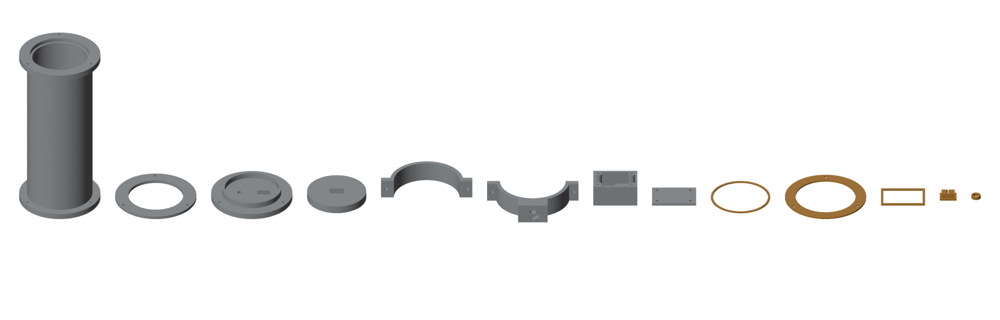

# The beam's enclosures (second version)

Made in Blender 5.2 by `beam_enclosures.py`. `stl/` has one print file per part, already
in its print orientation, in millimetres. `beam_enclosures.blend` keeps the same parts for
editing. This second version has as few parts as can be: six, all PETG, every joint sealed
with neutral-cure silicone instead of gaskets, two screws in all (spec 002, FR-013,
FR-016). It has not been printed yet.

## The parts

| File | Count | What it is |
| --- | --- | --- |
| `receiver_tube.stl` | 1 | The receiver's body: the lens against a shoulder at its front, the sensor and the board inside, a boss underneath for a camera tripod. |
| `receiver_hood.stl` | 1 | Slides over the tube's front and reaches 100 mm ahead of it: keeps the sun from the side, rain and dew off the lens. |
| `receiver_sensor_carriage.stl` | 1 | Holds the light sensor module at the lens's focus. |
| `receiver_back_cap.stl` | 1 | Closes the tube on two screws: a slot for the USB cable, a window for the board's LED. |
| `emitter_box.stl` | 1 | The laser's box: the laser on a ledge, shining through a hole in the front, the power module behind it. |
| `emitter_lid.stl` | 1 | Closes the laser's box. |

## Printing

- **PETG.** 0.2 mm layers, 4 walls, 5 top and bottom layers, 25 to 40% infill, no supports.
  Every part lies on the print bed as exported.
- **The receiver's four parts in black**, so that no daylight comes through their walls and
  none is reflected inside onto the sensor. **The emitter in a light colour**, white or light
  grey: in the sun it stays cooler than a dark box, and a laser diode dims and wears out when
  it is hot.
- The tallest part is the tube, 172 mm, standing on its front: the boss beneath it slopes at
  45 degrees towards the bed, so it needs no support. The hood is 115 mm tall, on its front
  rim. A hood of its own lets the tube print on any printer of 180 mm or more; the two in one
  piece would be about 270 mm.
- **A 5 mm brim for the tube and the hood.** Each stands on a ring a few millimetres wide,
  and a tall part on so little can come off the bed late in its print.

## What else to buy

| Part | Count | Where it goes |
| --- | --- | --- |
| A 3x hand magnifier, 60 mm glass lens | 1 | Its lens, out of its frame, into the tube (see "The lens" below). |
| Red film: a lighting gel, or a red transparent folder | a 10 mm square | Over the photoresistor: it lets the red laser through and holds most of the daylight back (FR-012). |
| Neutral-cure silicone sealant, black or grey | 1 tube | Every joint. Not an acetic one, which smells of vinegar: its acid corrodes the boards. |
| Clear neutral-cure silicone, or clear epoxy | a drop | The board's LED window. |
| M3 x 8 screw | 2 | The back cap (they cut their thread in PETG). |
| 1/4-20 hex nut (camera thread) | 2 | Slid into the tube's boss and the laser box's ledge. |
| Hot glue | | The laser's board, and over the receiver's tripod nut. |
| Black tape (electrical tape) | a few cm | Round the sensor module in the carriage's slot. |
| A small bag of silica gel (as comes in a shoe box) | 2 | One in each part: it keeps the lens from misting inside. |
| A camera tripod with a pan and tilt head | 2 | One for the receiver, one for the emitter: aiming them. |

## The lens

The receiver is made for a 60 mm lens that focuses about 100 mm behind itself. A 3x hand
magnifier's lens is about that. Over 10 m, a lens catches the laser's spot anywhere on its
face and focuses it onto the sensor, so the spot may wander up to 2.5 cm without the beam
being lost. A bare sensor loses it after 3 mm (spec 002, FR-009, FR-012).

To find a lens's focal length, focus the sun, or a lamp across the room, onto a sheet of
paper: the distance from the lens to the sharpest spot is its focal length. The carriage
slides 10 mm either side of 100 mm. A lens further off changes three numbers at the top of
`beam_enclosures.py`: `LENS_D` (its diameter), `LENS_EDGE` (its thickness at the rim) and
`FOCAL`. Then build the parts again (below).

The sensor's place needs little care. Along the tube, 5 mm off the focus still puts the whole
spot on the photoresistor. Across it, none: a lens a little off centre puts the spot a
millimetre aside, and turning the receiver half a degree on its tripod brings it back, as
aiming does anyway.

**A lens is a burning glass.** In the sun it focuses 2 to 3 W into a spot of about a
millimetre. With the sun within some 17 degrees of the tube's axis, that spot falls inside
the tube, on the carriage: it can melt it and burn the sensor. Set the receiver up with its
back to the sun, the laser on the sunny side, and never leave it lying lens up in the sun.
The hood keeps off the sun further aside.

## Assembly

The receiver:

1. **Lens.** Lay the tube on its side. Push the lens in from the back, with the carriage,
   until it rests on the shoulder at the front, and leave the carriage against it. From the
   front, run a bead of silicone round the shoulder's edge, where the lens meets it. Leave
   the tube on its side for a day while the silicone cures, then take the carriage out.
2. **Hood.** Slide the hood over the tube's front until its lip meets the tube's end. Run a
   bead of silicone round the joint, at the hood's back edge.
3. **Sensor.** Stick a square of red film over the photoresistor. Push the sensor module
   through the carriage's slot, its trimmer too, until the photoresistor is in front, at the
   carriage's middle. Close the slot's gaps round the module with black tape, so that the
   carriage keeps every light behind it off the photoresistor: the board's own LED, and the
   sun through the LED window, which faces the sun when the receiver's back is to it. Slide
   the carriage in from the back, the photoresistor towards the lens, until the
   photoresistor is the lens's focal length behind the lens: a ruler through the back then
   reads 166 mm less the focal length from the tube's back end to it (66 mm for a 100 mm
   lens). A few millimetres either way do not matter. Fix the carriage there with a dab of
   silicone on its back edge: the cartridge's nozzle reaches it through the back, where a
   glue gun would not. Leave the tube on its side while it cures. Its trimmer is set as
   `beam/README.md` says (step 4), with the film on.
4. **Board.** Wire the board to the sensor as `beam/README.md` says. Fix the board, and the
   BT05 in the RP2040 kit, behind the carriage with foam tape, its LED 12 mm from the tube's
   middle towards one of the two screw holes near the back: the back cap's window goes
   there.
5. **Back cap.** Put a small bag of silica gel in behind the board: the sealed tube keeps
   the air it was closed on, and after a cold night that air's damp would mist the lens
   from inside and hide the beam. Pass the USB cable through the cap's slot and plug it
   into the board. Run a bead of silicone round the tube's back end and push the cap in,
   its window over the board's LED (the cap goes on two ways round). Drive the two M3 x 8
   screws through the tube's side holes into it, a dab of silicone on each. Fill the slot
   round the cable with silicone, and the window with clear silicone or epoxy.
6. **Tripod.** Slide a 1/4-20 nut into the slot in the boss's top, from the tube's back end
   side, until it drops to the bottom, and put a dab of hot glue over it: the slot opens
   along the tube, and off its tripod the receiver would shake the nut out. The tripod's
   screw goes into the hole in the boss's face; the plastic between them takes the pull, so
   a tightened screw cannot pull the nut out. Tie the USB cable to a leg of the tripod, the
   emitter's as well: a foot caught in it then pulls the tripod, not the board's socket
   through the silicone.

The emitter:

1. **Nut.** Slide a 1/4-20 nut into the slot at the back of the ledge until it is over the
   hole in the floor.
2. **Laser.** Lay the KY-008 on the ledge against the front wall, its barrel at the hole,
   and fix its board with a dab of hot glue: once aimed, the laser must not move. Run a bead
   of silicone round the barrel where it meets the front wall, inside, and keep it off the
   barrel's front: silicone on the laser's glass would smear the spot at 10 m.
3. **Power.** Pass the USB cable in through the slot at the back and plug it into the power
   module. Wire the module's VBUS to the laser's `S` pin and its GND to the `-` pin, with
   the 47 Ohm 1 W load across them if the power bank needs one (`beam/README.md`). The load
   turns half a watt into heat, its body near 100 degrees: stand it on its leads clear of
   the walls, the floor and the lid, where it cannot soften the PETG (about 80 degrees).
   Fix the module to the floor with foam tape, and fill the slot round the cable with
   silicone.
4. **Lid.** Put a small bag of silica gel in, as in the receiver. Run a bead of silicone
   round the box's top edge and press the lid on, its rim inside.

## Sealing

Every joint is sealed with neutral-cure silicone; nothing is a gasket. The cables stay
plugged in: the board is re-flashed and the power bank changed through them, without
opening anything (FR-013). A part can still be opened: cut its silicone with a knife, and
take out the back cap's screws. Whether this keeps out rain, dust and dew, as an IP65 class,
is found once the first ones are printed and sprayed (spec 002, T018); potting the
electronics or a conformal coating stay the fallbacks.

## Building the parts again

The script makes every part, writes `stl/` (removing the files of parts it no longer
makes), `preview.png` and `beam_enclosures.blend` beside itself, and says the parts' sizes.
Run it in any of these ways:

- **Through Blender's MCP add-on** (Blender Lab's, on `localhost:9876`): send it as one
  request, with `__file__` set to its path.
- **In Blender's Text Editor:** open the script, then Run Script.
- **Headless:** `blender -b -P beam/enclosures/beam_enclosures.py`.

Each way gives the same parts.
